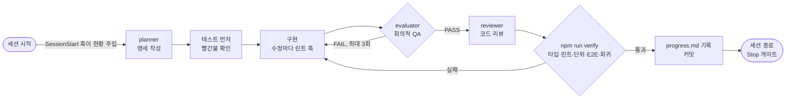

# 하네스 설계

> **에이전트 = 모델 + 하네스.** 모델을 바꾸지 않아도, 모델을 둘러싼 환경(규칙, 도구, 검증, 기록)을 설계하면 에이전트는 훨씬 안정적으로 일한다.

이 문서는 Devlog 저장소의 하네스가 **어떤 실패를 막으려고 무엇을 만들었는지** 설명한다.

## 전체 흐름

## 막으려는 실패와 대응

| 에이전트가 흔히 하는 실패 | 하네스의 대응 | 구현 |
| --- | --- | --- |
| 이전 세션에서 뭘 했는지 모른 채 시작한다 | 세션 시작 시 진행률, 다음 후보, 최근 커밋, 마지막 기록을 자동 주입 | `SessionStart` 훅 → `progress.mjs` |
| 한 번에 너무 많이 하다가 중간에 끊긴다 | 기능 목록을 40개로 쪼개고, 한 세션에 하나만 | `feature_list.json`, `/next-feature` |
| 테스트 없이 "다 됐어요"라고 선언한다 | 완료 기록은 검증 스크립트만 할 수 있고, 에이전트의 직접 수정은 훅이 막음 | `verify-feature.mjs`, `guard-files` 훅 |
| 테스트를 약하게 고쳐서 통과시킨다 | 통과한 기능의 테스트는 수정 금지 + 해시로 변조 검사, skip/only 금지 | `guard-files` 훅, verify의 해시 검사 |
| 새 기능을 만들다 옛 기능을 깨뜨린다 | verify가 통과한 모든 기능의 E2E를 함께 실행 (회귀 검사) | `verify-feature.mjs` |
| 자기 작업을 후하게 평가한다 | 구현과 평가를 분리. 평가자는 코드 수정 불가, 스크린샷과 탐색 테스트로 증거 제시 | `evaluator` 서브에이전트, 역할별 쓰기 범위 |
| 린트·타입 오류를 쌓아 두고 끝낸다 | 수정 직후 그 파일 린트, 종료 시 타입·린트·단위 테스트 게이트 | `lint-on-edit`, `stop-gate` 훅 |
| 강제 push, hard reset 같은 위험한 명령 | 명령 단위로 차단 | `guard-bash` 훅 |
| 오래된 기억으로 프레임워크 API를 쓴다 | 설치된 버전의 문서(`node_modules/next/dist/docs/`)를 읽도록 지도에 명시 | `AGENTS.md` |
| 같은 실수를 반복한다 | 실수마다 원인을 분류하고 규칙을 하나씩 추가 (래칫) | `/log-failure`, `harness/harness-log.md` |

## 구성 요소

### 1. 지도: `AGENTS.md` (약 100줄)
모든 규칙을 한 파일에 몰아넣으면 에이전트가 중요한 것을 놓친다. `AGENTS.md` 는 절대 규칙, 명령, 디렉터리, 문서 위치만 담은 지도이고, 상세 규칙은 `docs/` 에 나눠 필요할 때 읽게 했다. (점진적 공개)

### 2. 상태 파일: `feature_list.json`, `progress.md`
에이전트는 세션이 끝나면 기억을 잃는다. 그래서 상태를 파일과 git에 남긴다.
- `feature_list.json`: 기능 40개와 수용 기준. 모두 "미완료"로 시작한다.
- `progress.md`: 세션마다 무엇을 했고 다음 세션이 알아야 할 것.

### 3. 역할 분리: 서브에이전트
| 역할 | 할 수 있는 것 | 할 수 없는 것 |
| --- | --- | --- |
| planner | 명세 작성 (`docs/specs/`) | 코드 작성 |
| (메인 세션) | 테스트와 구현 | 완료 기록, 하네스 수정 |
| evaluator | 테스트 실행, 스크린샷 확인, 탐색 테스트 (`e2e/_eval/`) | 코드 수정 |
| reviewer | 변경 사항 읽고 의견 | 파일 수정 |

역할별 쓰기 범위는 문서로만 정한 게 아니라 `guard-files` 훅이 `agent_type` 을 보고 강제한다.

### 4. 기계적 강제: 훅
| 훅 | 시점 | 하는 일 |
| --- | --- | --- |
| `session-start.mjs` | 세션 시작, 컨텍스트 압축 후 | 진행 현황 주입 |
| `guard-files.mjs` | 파일 수정 전 | 보호 파일, 통과한 테스트, 역할 밖 수정 차단 |
| `guard-bash.mjs` | 셸 명령 전 | 위험 명령, 셸을 통한 우회 차단 |
| `lint-on-edit.mjs` | 파일 수정 후 | 그 파일만 ESLint, 오류를 즉시 돌려줌 |
| `stop-gate.mjs` | 종료하려 할 때 | 코드가 바뀌었으면 타입·린트·단위 테스트, 실패 시 종료 차단 (최대 3회) |

판단 로직은 `scripts/harness/lib/guards.mjs` 에 순수 함수로 두고 **단위 테스트로 검증**한다. 하네스도 코드이므로 테스트한다.

### 5. 완료의 정의: `npm run verify -- <ID>`
테스트 파일 검사 → 변조 검사 → 타입·린트·단위 테스트 → 이 기능과 이전 기능 전부의 E2E. 모두 통과해야 `passes: true` 가 기록된다.

### 6. 측정: `npm run metrics`
하네스가 효과가 있는지 수치로 본다. 모든 검증 시도와 훅 차단은 `harness/logs/*.jsonl` 에 남는다.
- 첫 검증에 통과한 비율, 기능당 평균 검증 시도
- 실패가 몰리는 단계 (예: lint에 몰리면 린트 훅을 강화)
- 훅이 막은 행동 수, 규칙별 분포
- 실패에서 추가된 하네스 규칙 수

## 사람의 역할
- 기능 목록과 수용 기준을 정한다. (무엇을 만들지)
- 에이전트의 실패를 보고 하네스를 고친다. (`/log-failure`)
- 하네스 파일은 보호되어 있어, 사람이 유지보수 모드로 켠 세션에서만 수정된다: `$env:HARNESS_MAINTENANCE=1; claude`

## 참고한 자료
- OpenAI, [Harness engineering: leveraging Codex in an agent-first world](https://openai.com/index/harness-engineering/) (2026-02) — 지도로서의 AGENTS.md, 규칙의 기계적 강제
- Anthropic, [Effective harnesses for long-running agents](https://www.anthropic.com/engineering/effective-harnesses-for-long-running-agents) (2025-11-26) — 기능 목록, 진행 기록, 세션 간 인계, 브라우저 테스트
- Addy Osmani, [Agent Harness Engineering](https://addyosmani.com/blog/agent-harness-engineering/) (2026-04-19) — 래칫 원칙, 훅, 계획·생성·평가 분리
- Next.js, AI 코딩 에이전트 가이드 (`node_modules/next/dist/docs/01-app/02-guides/ai-agents.md`) — 버전에 맞는 문서 참조
